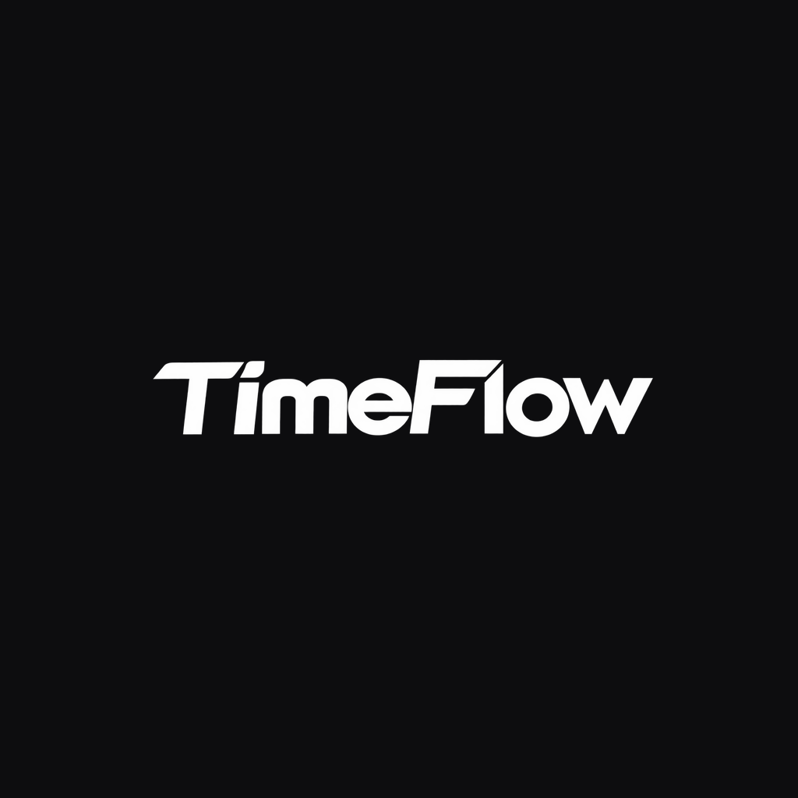

 <div align="center">



# TimeFlow

### Time flows. Make it count.

*A focused space for your deadlines, time, and thoughts.*

TimeFlow is a dark, offline-first productivity app that brings a live deadline countdown, a stopwatch, and a personal notes workspace together in one minimal experience — available on the web and Android.

<p>
  <a href="./TimeFlow-debug.apk"></a>
  <a href="https://github.com/Lavish09-Mehra/TimeFlow"></a>
  <a href="https://www.linkedin.com/in/lavish09dev"></a>
</p>

<p>
  
  
  
  
  
  
</p>

</div>

---

## ✦ Overview

TimeFlow is built around one simple idea:

> **Make the time you have left impossible to ignore.**

Instead of switching between multiple productivity tools, TimeFlow gives you three essentials in one distraction-free workspace.

| Feature | Description |
|---|---|
| **Deadline Countdown** | Track a meaningful deadline down to the second. |
| **Stopwatch** | Record focused sessions and revisit previous days. |
| **Notes Workspace** | Capture thoughts, organize checklists, and draw sketches. |

**Designed to stay personal.** Your deadlines, notes, and sessions are stored locally on your device. No account or backend is required.

## ◈ Features

### 01 — Deadline Countdown

Keep your most important deadline in view.

- Live countdown with months, weeks, days, hours, minutes, and seconds.
- Month-aware date calculations.
- A finished state when your target time arrives.
- Persistent deadline settings across launches.
- A first-run commitment flow that asks you to define why your deadline matters.

### 02 — Commitment by Design

Changing your deadline is intentionally deliberate.

When you attempt to change an active target, TimeFlow presents a **Note to Self** step before unlocking the date picker.

It is a small moment of reflection designed to help you reconsider your decision rather than change your goal casually.

### 03 — Stopwatch & Focus Sessions

Track your time without leaving your workspace.

- Start, pause, resume, and reset controls.
- Daily session tracking.
- Earlier-day session history.
- Locally persisted timer state and session records.

### 04 — Personal Notes

A minimal workspace for the things you need to remember.

- Create and edit text notes.
- Pin important notes.
- Organize notes by category.
- Choose from multiple note colors.
- Create interactive checklists.
- Draw sketches on a canvas and save them as notes.
- Confirm before deleting notes.

### 05 — Your Workspace, Your Way

- Dark, distraction-free interface.
- Curated and custom background colors.
- Responsive layout for mobile and desktop.
- Android support through Capacitor.
- External links open through the system browser on Android.

---

## ◇ Tech Stack

| Technology | Role |
|---|---|
| React | User interface |
| TypeScript | Type-safe development |
| Vite | Development server and production build |
| Tailwind CSS | Styling utilities |
| Lucide React | Icons |
| Capacitor | Android integration |
| Browser `localStorage` | Local persistence |
| Gradle | Native Android build |

---

## ◇ Getting Started

### Prerequisites

- Node.js 20 or later
- npm
- A modern web browser

### 1. Clone the repository

```bash
git clone https://github.com/Lavish09-Mehra/TimeFlow.git
cd TimeFlow
```

### 2. Install dependencies

```bash
cd Frontend
npm install
```

### 3. Start the development server

```bash
npm run dev
```

Open the local URL printed by Vite in your browser.

### 4. Create a production build

```bash
npm run build
```

The production files will be generated in `Frontend/dist/`.

### Available commands

| Command | Purpose |
|---|---|
| `npm run dev` | Start development |
| `npm run build` | Type-check and build |
| `npm run preview` | Preview the production build |
| `npm run lint` | Run ESLint |

---

## ◇ Android

TimeFlow uses Capacitor to package its web experience as an Android application.

**Download:** [TimeFlow-debug.apk](./TimeFlow-debug.apk)

| Detail | Value |
|---|---|
| Application ID | `com.timeflow.app` |
| Version | `1.0` |
| Minimum Android | Android 7.0 (API 24) |
| Build type | Debug APK |

### Build from source

From the repository root:

```bash
./scripts/build-apk.sh
```

Or build manually:

```bash
cd Frontend
npm run build
npx cap sync android
cd android
./gradlew assembleDebug
```

The manually generated APK is located at:

```text
Frontend/android/app/build/outputs/apk/debug/app-debug.apk
```

> **Note:** The included APK is a debug build intended for personal installation and testing, not a production Play Store release.

---

## ◇ Privacy & Data

**Your workspace stays on your device.**

TimeFlow stores its countdown settings, notes, checklists, sketches, and stopwatch history using browser or Android WebView `localStorage`.

- No account is required.
- No application backend is required.
- Personal workspace data is not uploaded to a TimeFlow server.
- There is currently no cloud synchronization or automatic backup.

**Important:** Clearing browser site data, clearing Android app storage, or uninstalling the application can remove locally stored data. Keep your own backup of anything important.

---

## ◇ Project Structure

```text
TimeFlow/
├── Frontend/
│   ├── src/
│   │   ├── App.tsx
│   │   ├── AndroidNotepad.tsx
│   │   ├── main.tsx
│   │   └── index.css
│   ├── public/
│   │   └── stopwatch.html
│   ├── assets/
│   ├── android/
│   ├── package.json
│   ├── capacitor.config.ts
│   └── vite.config.ts
├── scripts/
│   └── build-apk.sh
├── TimeFlow-debug.apk
├── LICENSE
└── README.md
```

---

## ◇ Roadmap

The project can continue evolving around a few practical improvements:

- [ ] Export and import local data.
- [ ] Deadline notifications and reminders.
- [ ] Home-screen countdown widget.
- [ ] Automated tests for date calculations and persistence.
- [ ] Improved tablet layouts and accessibility.
- [ ] More canvas tools and note templates.
- [ ] Optional privacy-first synchronization.
- [ ] Release-signed Android builds.

---

## ◇ Contributing

Suggestions, bug reports, and contributions are welcome.

1. Fork this repository.
2. Create a feature branch.
3. Make your changes.
4. Run `npm run lint` and `npm run build` from `Frontend/`.
5. Open a pull request with a clear description.

For UI contributions, please preserve TimeFlow's minimal dark theme and compact, mobile-friendly layout.

---

## ◇ About the Project

TimeFlow is an independent project built to combine deadline awareness, time tracking, and personal notes in a single focused experience.

**Built by Lavish Mehra**

- GitHub: [@Lavish09-Mehra](https://github.com/Lavish09-Mehra)
- LinkedIn: [lavish09dev](https://www.linkedin.com/in/lavish09dev)
- Repository: [Lavish09-Mehra/TimeFlow](https://github.com/Lavish09-Mehra/TimeFlow)

If you like the idea, consider starring the repository ⭐

---

## License

TimeFlow is released under the [MIT License](./LICENSE).

Copyright © 2026 Lavish Mehra.
